# 礼林｜圆方共融二十色与中拼音

企业：达州礼林生态科技有限责任公司。日期：2026年11月25日。编号C01–C20。结构来源：重点候选91「圆方共融」（总档案191）。

[20套总览](colors-bilingual-20.png) · [逐套预览](预览.html) · [完整设计参数与提示](design-specs.json) · [生成与制作记录](manifest.json)

## 设计原则

保留圆方共融的主要轮廓、中心菱形、上挑与下侧开放关系，去掉原有蓝紫青连续渐变。以明确的两至三色组合比较清新、醒目、自然、温暖与克制等不同品牌气质。配色不等于公司业务范围；不加入建筑、齿轮或芯片图示。

善心由中心留白与接纳表达，善念由带面承接表达，善行由开口、延伸与连接表达。理念沿用图形逻辑，不再添加口号。

品牌中文仅采用“礼林”或“礼林生态”。拼音字标比较LILIN、LI LIN、li lin、Lilin、LILIN SHENGTAI与LI LIN SHENG TAI等排版写法；这些是品牌字标的拼音研究，不另立英文公司名称。

## 中拼音层级

- 中文主标／拼音副标：图标上置，中文居中，拼音以较小字号置于下方。
- 横向中拼音组合：图标左置，右侧中文与拼音上下对齐。
- 拼音主标／中文副标：图标上置，较大拼音突出品牌简称，中文在下方确认名称。

## 逐套设计

### C01 青黛柠黄

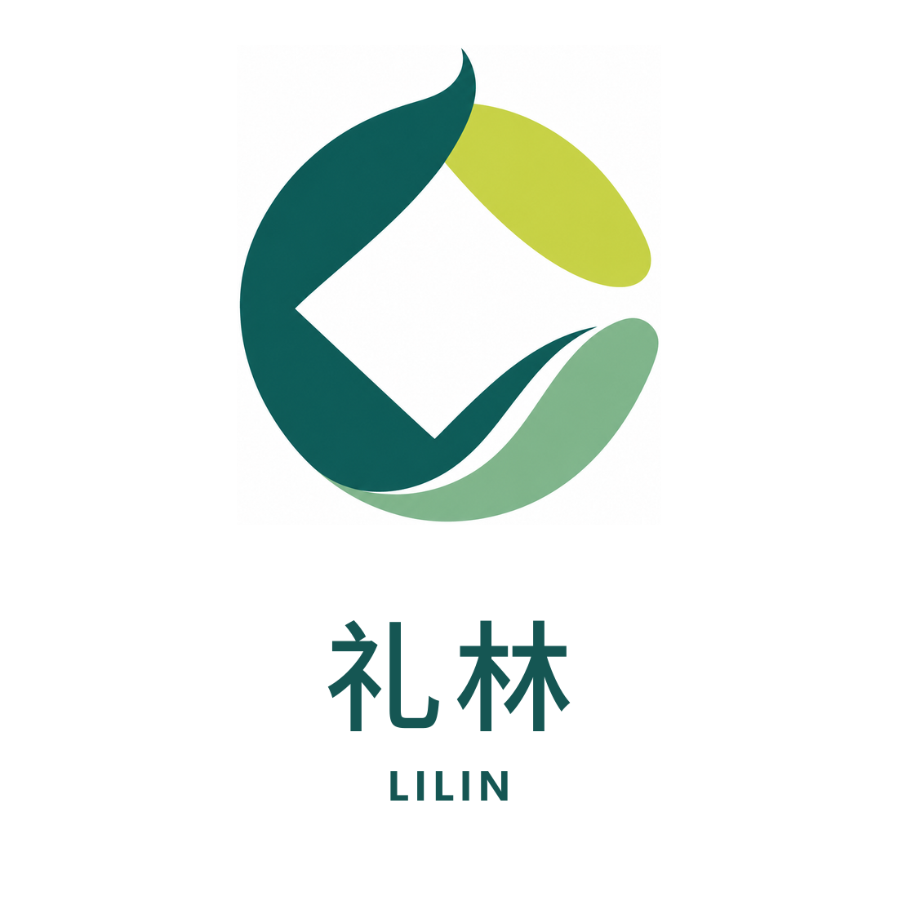

- 配色目标：#155653 / #CCD94B / #87B790。
- 字标颜色：#155653。
- 中文：礼林；Noto Sans SC Medium；字距参数18。
- 拼音：LILIN；Segoe UI Bold；字距参数25。
- 组合：中文主标／拼音副标。
- 评估：深青配柠黄较清新，中黑中文与紧凑大写拼音形成稳定层级。
- [PNG组合](C01-lockup.png) · [文字转曲SVG](C01-lockup.svg) · [未修改生成原图](originals/C01-exec-1ffed5af-bfc6-4408-91ce-fe06c63641ce.png)

### C02 湖绿珊瑚

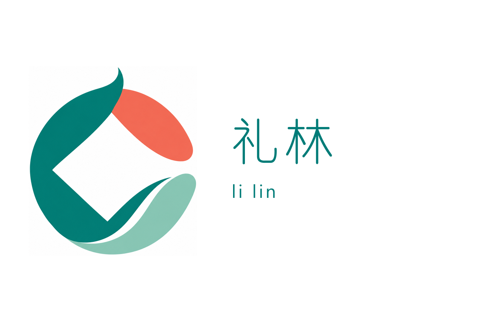

- 配色目标：#007C78 / #F36C5B / #8BC5B8。
- 字标颜色：#007C78。
- 中文：礼林；幼圆；字距参数22。
- 拼音：li lin；Segoe UI；字距参数24。
- 组合：横向中拼音组合。
- 评估：湖绿与珊瑚形成冷暖对比，圆体中文和小写拼音更亲和；缩小时文字偏轻。
- [PNG组合](C02-lockup.png) · [文字转曲SVG](C02-lockup.svg) · [未修改生成原图](originals/C02-exec-82172ab4-87af-406c-883c-8db4d2261871.png)

### C03 石墨电橙

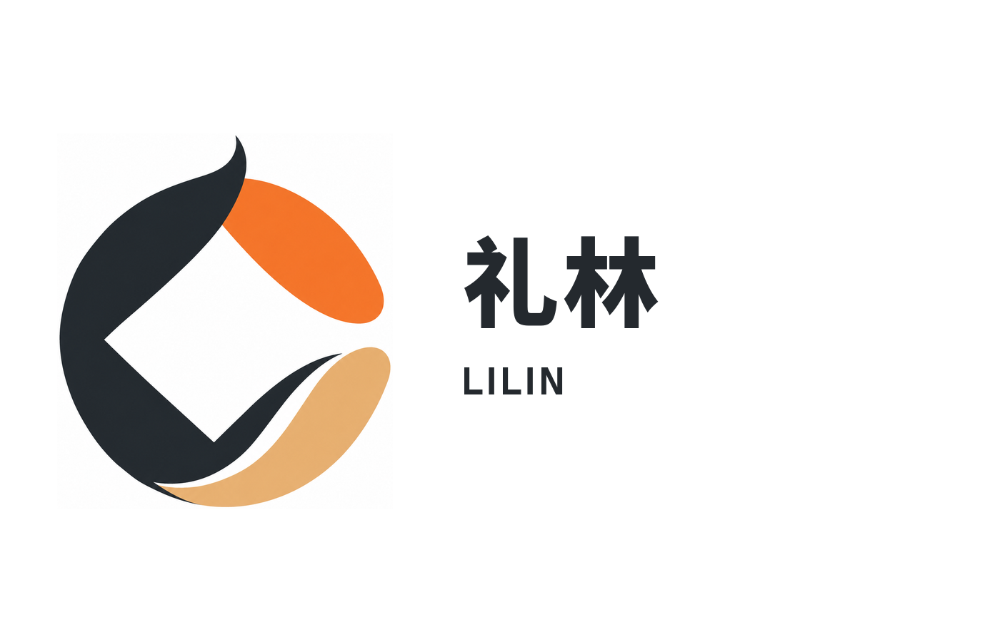

- 配色目标：#24292E / #F77B31 / #E7B47A。
- 字标颜色：#24292E。
- 中文：礼林；Noto Sans SC Black；字距参数8。
- 拼音：LILIN；Bahnschrift Bold；字距参数16。
- 组合：横向中拼音组合。
- 评估：石墨与亮橙形成强对比，厚黑中文和紧凑拼音有工具型软件气质。
- [PNG组合](C03-lockup.png) · [文字转曲SVG](C03-lockup.svg) · [未修改生成原图](originals/C03-exec-324747f8-e022-40c6-bbab-8ac0c8037270.png)

### C04 松绿米杏

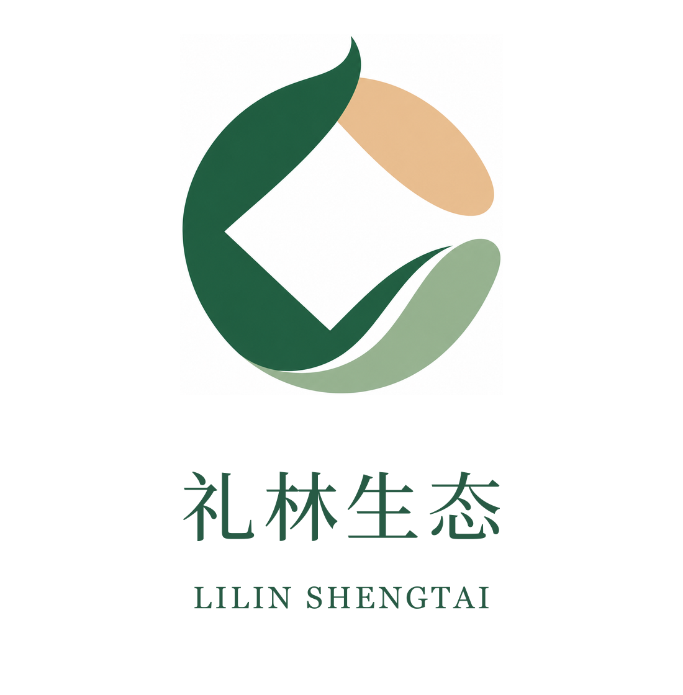

- 配色目标：#285B45 / #E9C69D / #A1B598。
- 字标颜色：#285B45。
- 中文：礼林生态；Noto Serif SC Medium；字距参数18。
- 拼音：LILIN SHENGTAI；Georgia；字距参数22。
- 组合：中文主标／拼音副标。
- 评估：松绿与米杏温和，宋体中文加衬线拼音偏人文，四字名称完整。
- [PNG组合](C04-lockup.png) · [文字转曲SVG](C04-lockup.svg) · [未修改生成原图](originals/C04-exec-2aafaba8-c88d-4898-86e4-ab319c9c9c3f.png)

### C05 莓红月白

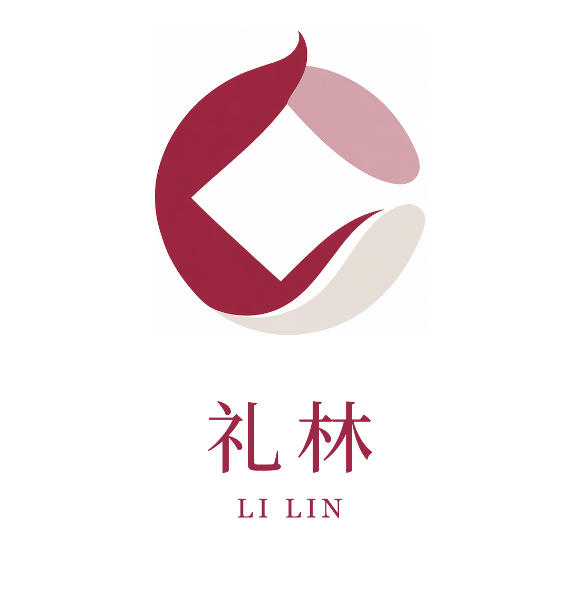

- 配色目标：#9D2946 / #D5A7B1 / #EAE4DE。
- 字标颜色：#9D2946。
- 中文：礼林；Noto Serif SC Medium；字距参数32。
- 拼音：LI LIN；Georgia；字距参数36。
- 组合：中文主标／拼音副标。
- 评估：莓红辨识度较强，分词衬线拼音与雅宋中文形成较舒展的节奏。
- [PNG组合](C05-lockup.png) · [文字转曲SVG](C05-lockup.svg) · [未修改生成原图](originals/C05-exec-beca0764-a023-491e-92ae-049681356459.png)

### C06 朱红墨黑

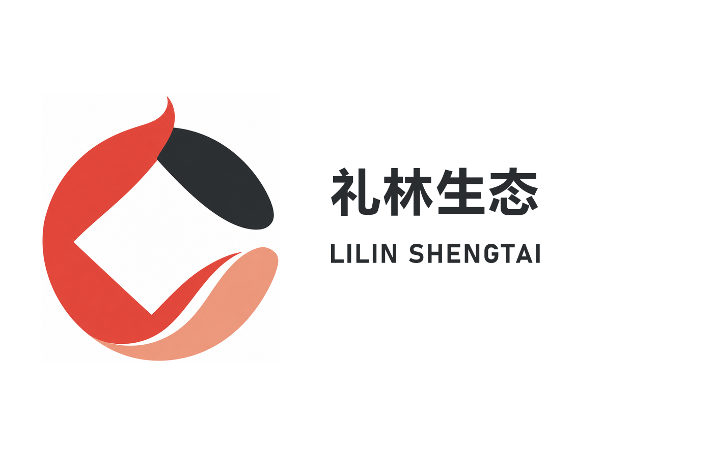

- 配色目标：#E44D42 / #292D30 / #EEA28A。
- 字标颜色：#292D30。
- 中文：礼林生态；Microsoft YaHei UI Bold；字距参数10。
- 拼音：LILIN SHENGTAI；Bahnschrift Bold；字距参数10。
- 组合：横向中拼音组合。
- 评估：朱红与墨黑较醒目，四字厚黑中文与大写拼音形成紧凑横向组合；文字已改为墨黑。
- [PNG组合](C06-lockup.png) · [文字转曲SVG](C06-lockup.svg) · [未修改生成原图](originals/C06-exec-bdeef044-493c-4cc4-a65d-e0bc50bf0a60.png)

### C07 芥黄墨绿

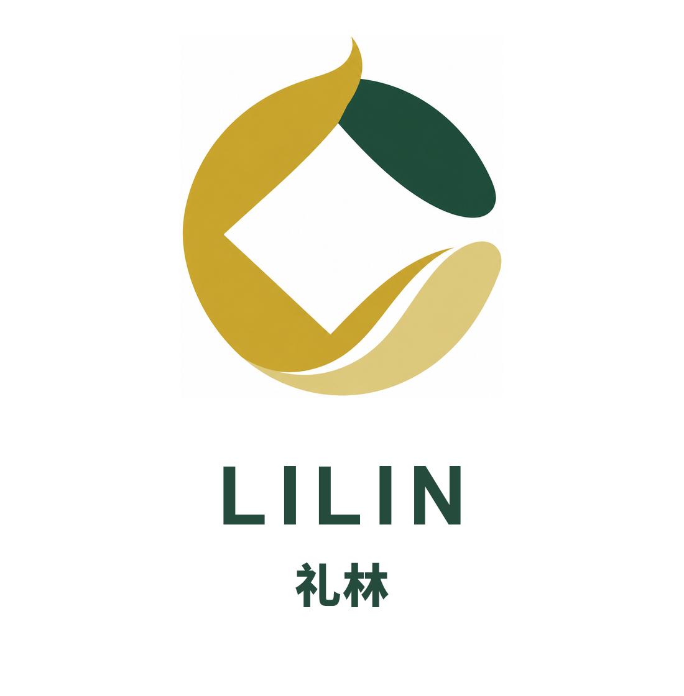

- 配色目标：#CCAA35 / #244B3B / #E2CF86。
- 字标颜色：#244B3B。
- 中文：礼林；Noto Sans SC Black；字距参数6。
- 拼音：LILIN；Arial Bold；字距参数28。
- 组合：拼音主标／中文副标。
- 评估：芥黄配墨绿较有个性，拼音为主标；已用深绿文字替代黄色文字。
- [PNG组合](C07-lockup.png) · [文字转曲SVG](C07-lockup.svg) · [未修改生成原图](originals/C07-exec-398582f7-9bda-4ee9-89e1-2a2341a5cc46.png)

### C08 海盐天青

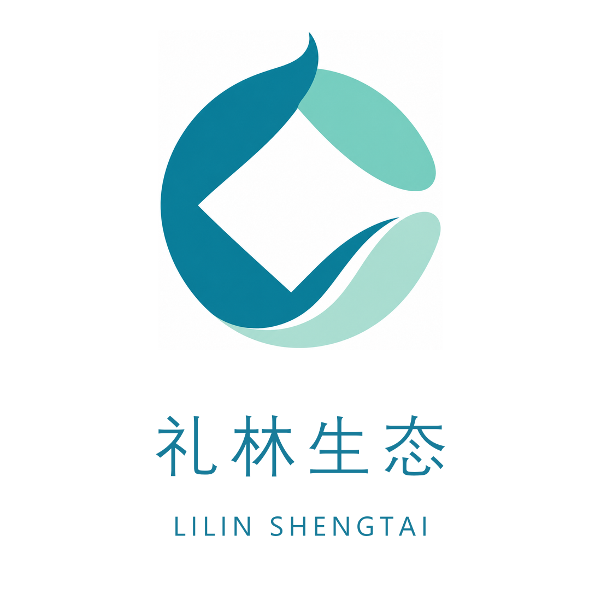

- 配色目标：#187C9A / #77CFC3 / #B5DFD5。
- 字标颜色：#187C9A。
- 中文：礼林生态；等线；字距参数28。
- 拼音：LILIN SHENGTAI；Segoe UI；字距参数35。
- 组合：中文主标／拼音副标。
- 评估：天青与海盐绿较轻快，等线中文和宽字距拼音偏清朗；小尺寸拼音较细。
- [PNG组合](C08-lockup.png) · [文字转曲SVG](C08-lockup.svg) · [未修改生成原图](originals/C08-exec-f614c9ae-9c49-41b9-aa1c-c1ed8fc5545a.png)

### C09 橄榄陶粉

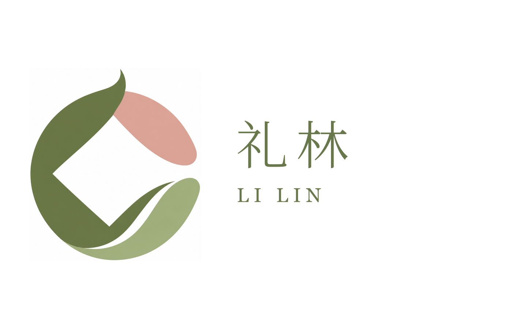

- 配色目标：#69784A / #DDA89C / #A6B386。
- 字标颜色：#69784A。
- 中文：礼林；Noto Serif SC Light；字距参数30。
- 拼音：LI LIN；Georgia；字距参数50。
- 组合：横向中拼音组合。
- 评估：橄榄与陶粉偏自然，轻宋中文和分词拼音更温和；细笔画适合较大展示。
- [PNG组合](C09-lockup.png) · [文字转曲SVG](C09-lockup.svg) · [未修改生成原图](originals/C09-exec-e861113d-8c52-4a92-a1b6-f3c98cc76680.png)

### C10 咖墨奶油

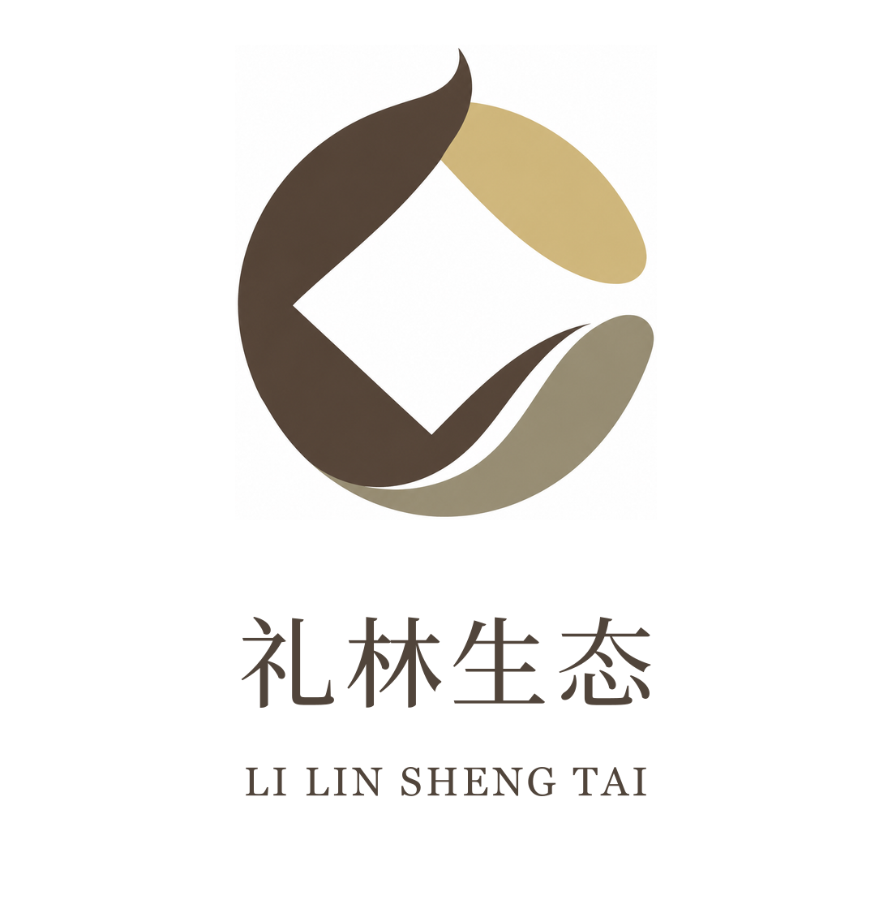

- 配色目标：#51453B / #D5BD85 / #9D9278。
- 字标颜色：#51453B。
- 中文：礼林生态；Noto Serif SC Medium；字距参数15。
- 拼音：LI LIN SHENG TAI；Georgia；字距参数18。
- 组合：中文主标／拼音副标。
- 评估：咖墨与奶油偏温暖沉稳，四字中文与四词拼音呈完整品牌名称。
- [PNG组合](C10-lockup.png) · [文字转曲SVG](C10-lockup.svg) · [未修改生成原图](originals/C10-exec-7b46ce58-1d5d-48c6-9140-79703905c0af.png)

### C11 黑白荧绿

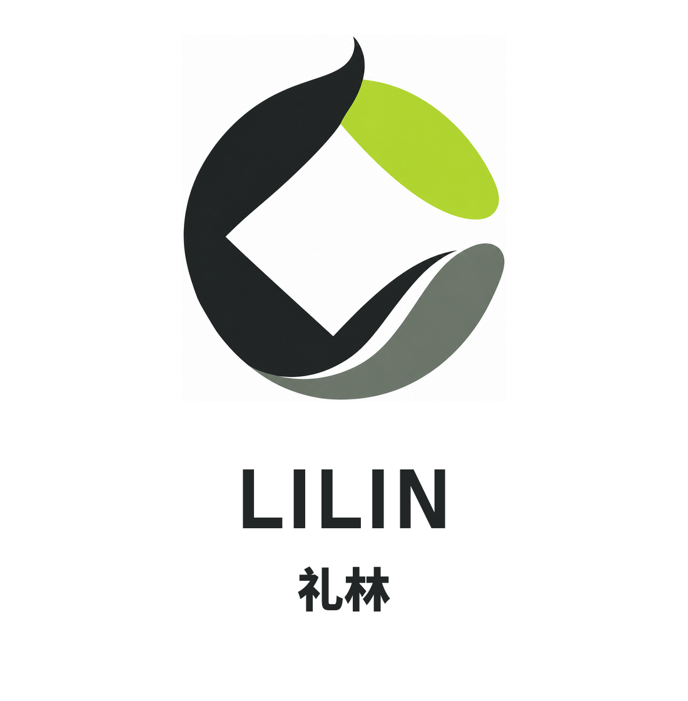

- 配色目标：#232626 / #B9DD38 / #70796B。
- 字标颜色：#232626。
- 中文：礼林；Noto Sans SC Black；字距参数0。
- 拼音：LILIN；Bahnschrift Bold；字距参数10。
- 组合：拼音主标／中文副标。
- 评估：黑色与亮荧绿有鲜明对比，拼音主标更突出软件产品气质，中文作确认。
- [PNG组合](C11-lockup.png) · [文字转曲SVG](C11-lockup.svg) · [未修改生成原图](originals/C11-exec-f0dd4a4d-9254-4c35-abe6-019f7d05bb6c.png)

### C12 莓红杏橙

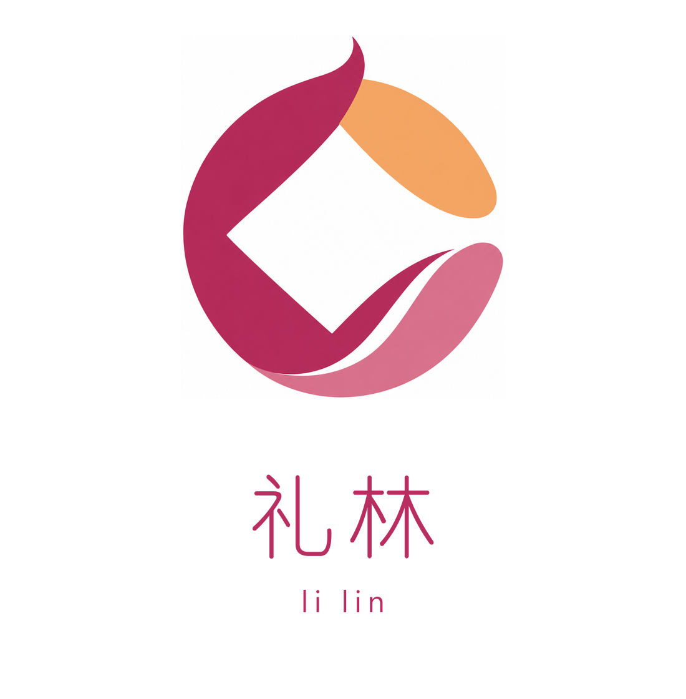

- 配色目标：#B92E61 / #F4AD6B / #DC7190。
- 字标颜色：#B92E61。
- 中文：礼林；幼圆；字距参数26。
- 拼音：li lin；Segoe UI；字距参数38。
- 组合：中文主标／拼音副标。
- 评估：莓红与杏橙明快，圆体中文和小写拼音更轻松，适合比较年轻亲和方向。
- [PNG组合](C12-lockup.png) · [文字转曲SVG](C12-lockup.svg) · [未修改生成原图](originals/C12-exec-95e438f4-ea63-4cbd-afd6-a76972e3d903.png)

### C13 靛青铜金

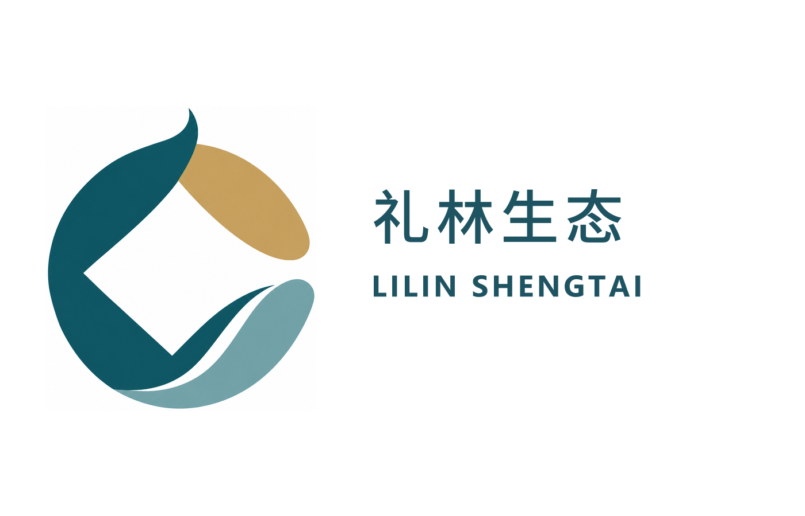

- 配色目标：#1E5462 / #C8A464 / #76A3A9。
- 字标颜色：#1E5462。
- 中文：礼林生态；Noto Sans SC Medium；字距参数20。
- 拼音：LILIN SHENGTAI；Segoe UI Bold；字距参数20。
- 组合：横向中拼音组合。
- 评估：靛青与铜金较稳健，中文与拼音均采用现代无衬线，适合企业横版组合。
- [PNG组合](C13-lockup.png) · [文字转曲SVG](C13-lockup.svg) · [未修改生成原图](originals/C13-exec-e436eaec-d46c-44bc-9885-42f10dbe376f.png)

### C14 薄荷深墨

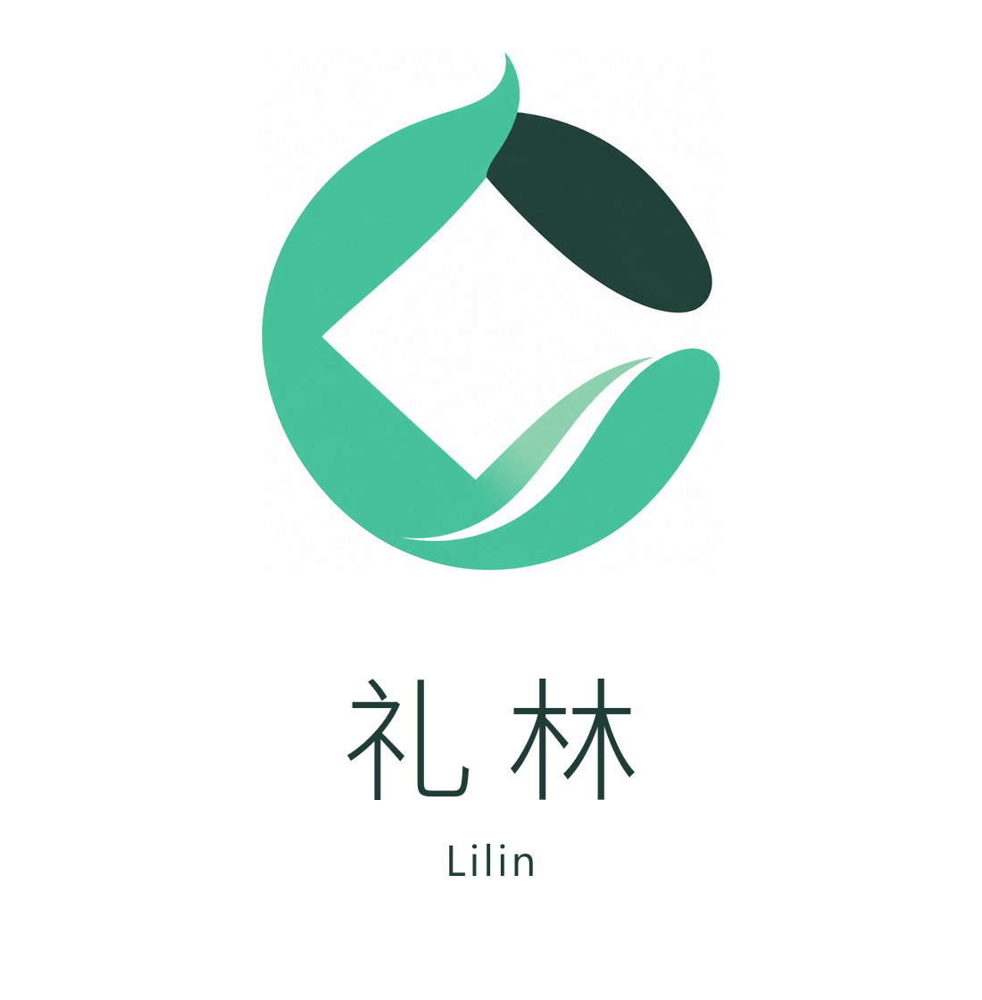

- 配色目标：#50C6A0 / #1F3D36 / #9ED9BB。
- 字标颜色：#1F3D36。
- 中文：礼林；Noto Sans SC Light；字距参数46。
- 拼音：Lilin；Segoe UI；字距参数16。
- 组合：中文主标／拼音副标。
- 评估：薄荷与深墨清新，轻字重中文配首字母大写拼音；文字已使用深墨保证对比。
- [PNG组合](C14-lockup.png) · [文字转曲SVG](C14-lockup.svg) · [未修改生成原图](originals/C14-exec-803bbd51-b666-43d2-b080-68e778e785f4.png)

### C15 孔雀朱砂

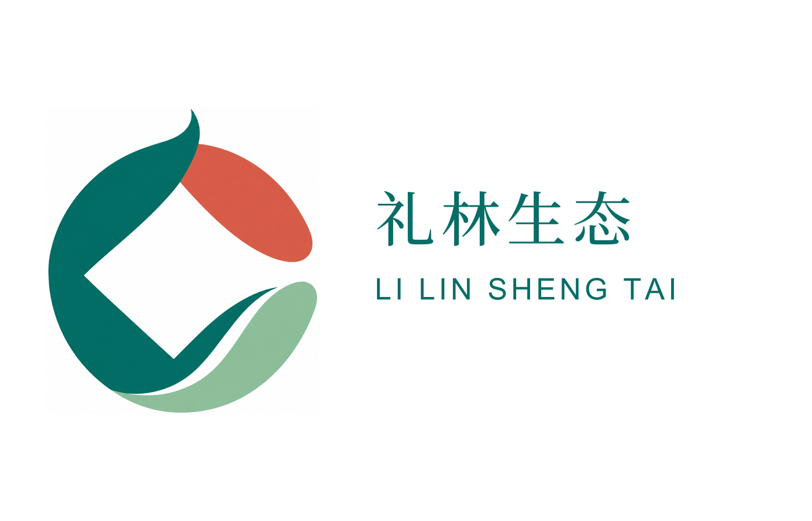

- 配色目标：#086D67 / #D9604B / #98C1A6。
- 字标颜色：#086D67。
- 中文：礼林生态；Noto Serif SC Medium；字距参数20。
- 拼音：LI LIN SHENG TAI；Arial；字距参数24。
- 组合：横向中拼音组合。
- 评估：孔雀绿与朱砂有冷暖对照，雅宋中文配无衬线分词拼音，兼具人文与秩序。
- [PNG组合](C15-lockup.png) · [文字转曲SVG](C15-lockup.svg) · [未修改生成原图](originals/C15-exec-8be87d3f-6cba-4b7c-ac19-7ee0ca798b2d.png)

### C16 焦糖青绿

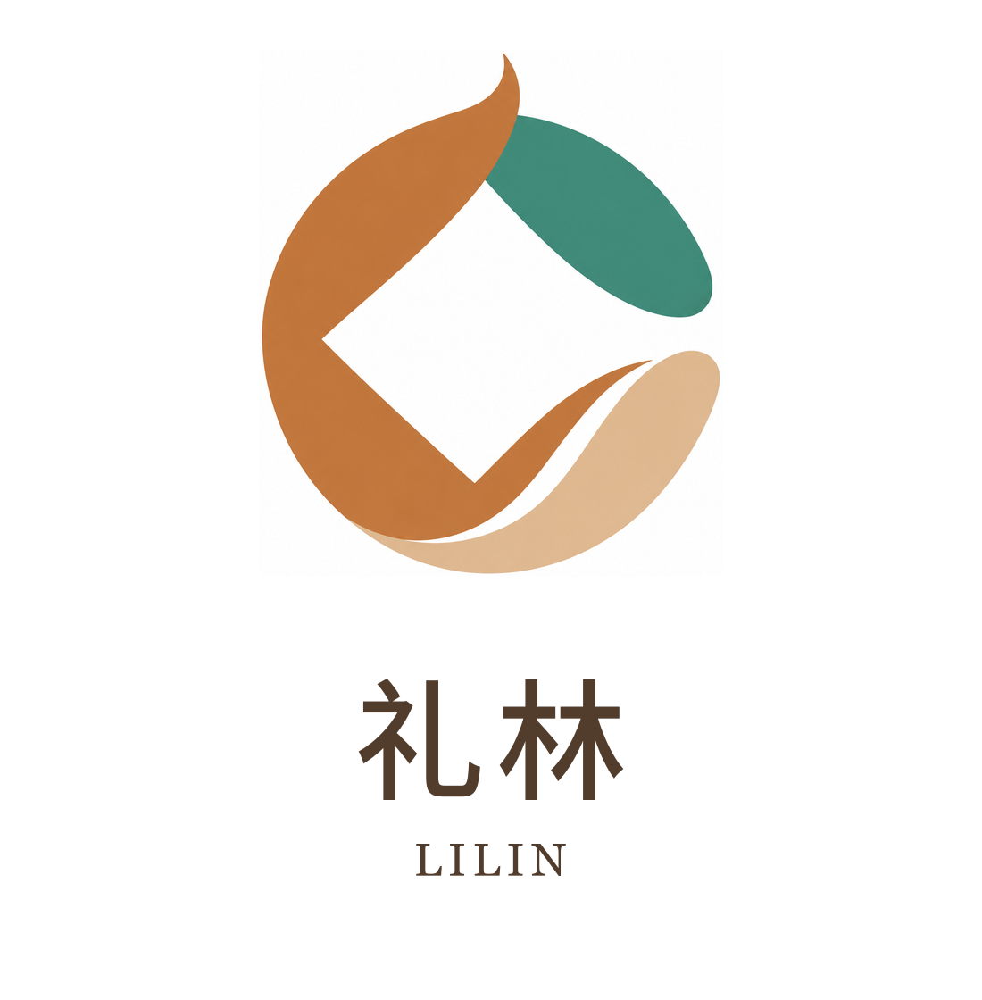

- 配色目标：#C67B3F / #408B7B / #E2C19C。
- 字标颜色：#523C2C。
- 中文：礼林；Noto Sans SC Medium；字距参数18。
- 拼音：LILIN；Georgia；字距参数28。
- 组合：中文主标／拼音副标。
- 评估：焦糖与青绿偏温暖，中文中黑配衬线拼音；文字使用深咖，与图标主色区分。
- [PNG组合](C16-lockup.png) · [文字转曲SVG](C16-lockup.svg) · [未修改生成原图](originals/C16-exec-e508b041-6326-4e3d-ae1d-5ef2e8a7668d.png)

### C17 深海米金

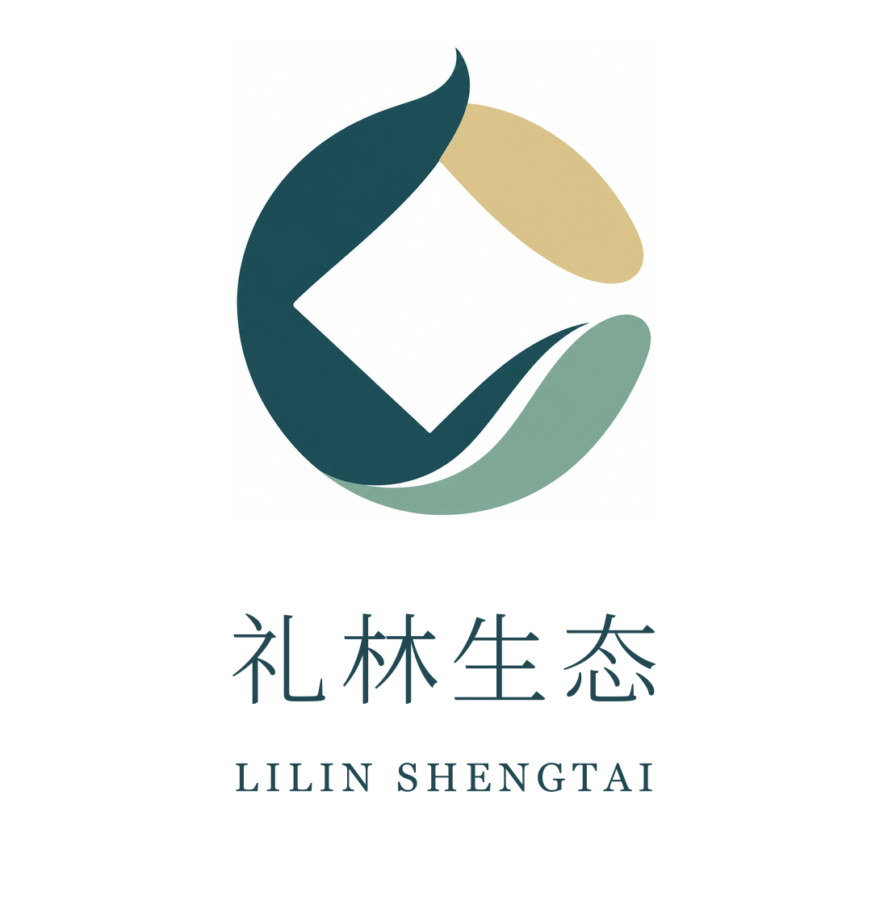

- 配色目标：#224953 / #DDCB98 / #88A99A。
- 字标颜色：#224953。
- 中文：礼林生态；Noto Serif SC Light；字距参数22。
- 拼音：LILIN SHENGTAI；Georgia；字距参数35。
- 组合：中文主标／拼音副标。
- 评估：深海与米金温和沉静，四字轻宋与衬线拼音较雅致；小尺寸笔画更轻。
- [PNG组合](C17-lockup.png) · [文字转曲SVG](C17-lockup.svg) · [未修改生成原图](originals/C17-exec-254e1bfd-d542-4b53-889b-1d8ccbafd797.png)

### C18 暖灰柠檬

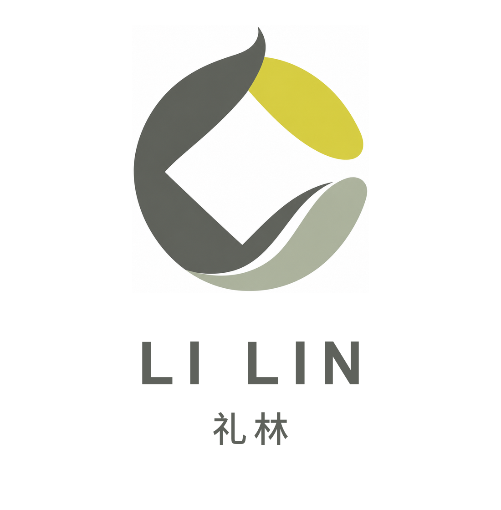

- 配色目标：#5F625C / #D9D44B / #B1B5A0。
- 字标颜色：#5F625C。
- 中文：礼林；Noto Sans SC Medium；字距参数36。
- 拼音：LI LIN；Arial Bold；字距参数40。
- 组合：拼音主标／中文副标。
- 评估：暖灰与柠檬黄较清爽，分词大写拼音为主、中文为副，形式较简洁。
- [PNG组合](C18-lockup.png) · [文字转曲SVG](C18-lockup.svg) · [未修改生成原图](originals/C18-exec-cfb50c9d-46ce-4c33-897e-862e7e24f6fa.png)

### C19 翠绿珊粉

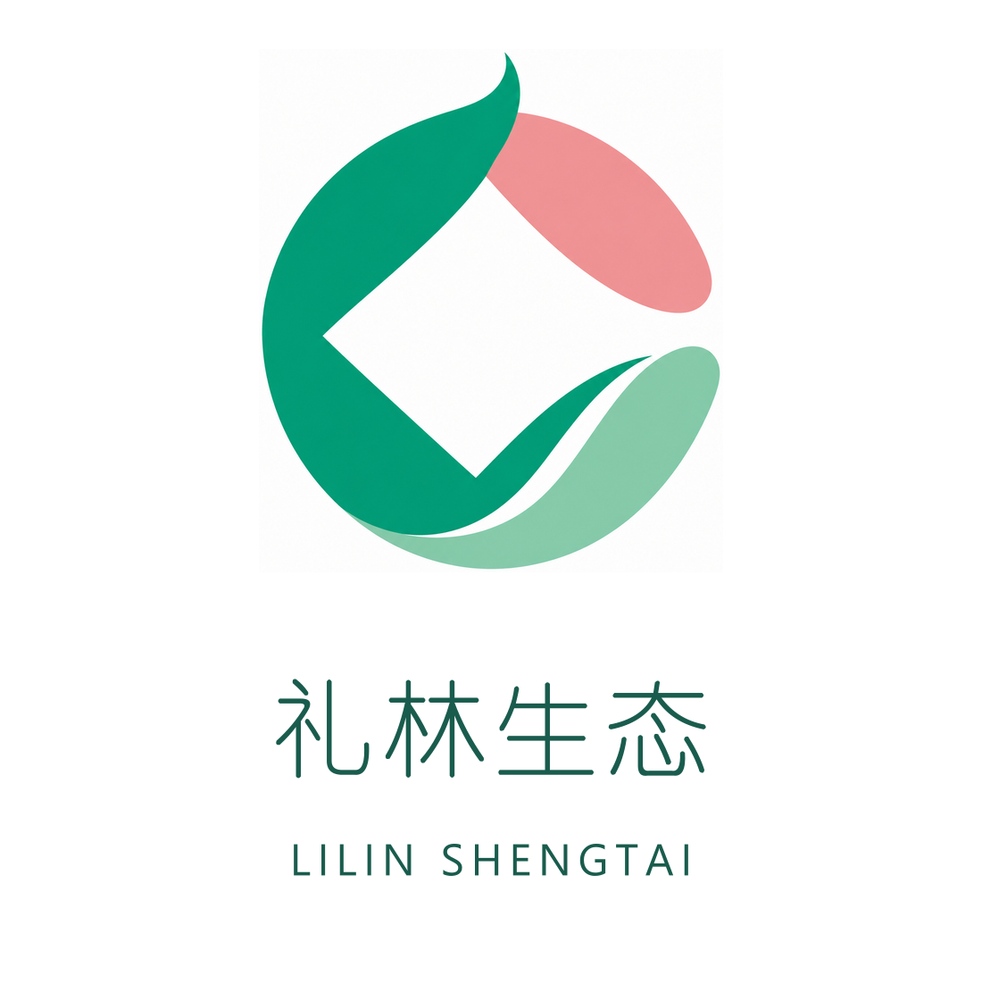

- 配色目标：#009B75 / #EF9A9E / #8BCDAF。
- 字标颜色：#195C4D。
- 中文：礼林生态；幼圆；字距参数15。
- 拼音：LILIN SHENGTAI；Segoe UI；字距参数30。
- 组合：中文主标／拼音副标。
- 评估：翠绿与珊粉明快亲和，四字圆体中文加无衬线拼音；已用深绿文字增加可读性。
- [PNG组合](C19-lockup.png) · [文字转曲SVG](C19-lockup.svg) · [未修改生成原图](originals/C19-exec-fb190279-e3aa-4822-be13-af0bc636c9b7.png)

### C20 晴空石墨

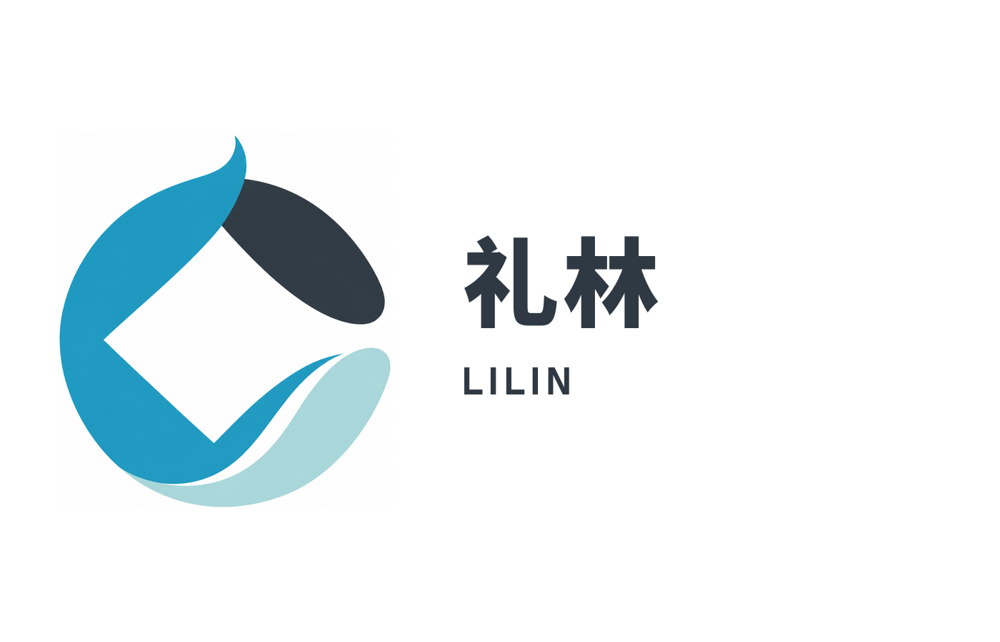

- 配色目标：#269CC4 / #2F3943 / #B5DBDE。
- 字标颜色：#2F3943。
- 中文：礼林；Noto Sans SC Black；字距参数8。
- 拼音：LILIN；Bahnschrift Bold；字距参数25。
- 组合：横向中拼音组合。
- 评估：晴空蓝与石墨没有蓝紫过渡，厚黑中文和紧凑大写拼音更偏软件工具，文字使用石墨。
- [PNG组合](C20-lockup.png) · [文字转曲SVG](C20-lockup.svg) · [未修改生成原图](originals/C20-exec-28a1eaea-c4a9-4178-aed2-037cfadc4e4e.png)

## 检查与制作

20套均检查大图、五组对照与220像素范围缩小组合，中文字形和拼音逐项核对。C06、C07、C14、C16、C19、C20已换成更深的字标颜色；细字重、小号拼音在缩小后仍可能弱于厚重中文，应按使用尺寸选择组合。

配色图形使用内置image_gen.imagegen工具，每套单独提示、独立生成，共20次。未用代码对图形进行创作性重绘或调色。System.Drawing仅导出实际中拼音字体的轮廓；SVG与sharp用于文字排版、裁边、等比缩放和总览合成。

色值为设计目标，生成PNG有轻微像素色差与轮廓差异，尚非统一的矢量母版。定稿时应按选中色值与91号统一轮廓制作母版。20个SVG的中文和拼音已转路径，不依赖查看者安装字体；图标为嵌入PNG，不标为全矢量图标。字体属于实际字体排版研究，不称为全新原创字库；不在档案中分发字体文件。

## 文件说明

- originals：20张工具生成原图，原字节保存；manifest附SHA-256及来源路径。
- inputs：重点图标91的参考原图。
- 生成记录：每套完整提示、工具和生成结果路径。
- design-specs.json：配色、中文、拼音、字体与组合类型。
- font-specs.json / glyph-outlines.json：字距参数与固定字形路径。
- C01–C20-lockup.png/svg：20套完整品牌组合。
- colors-bilingual-20.png：20套总览。
- detail-1至5 / qa-1至5：放大对照和缩小检查。

构建脚本保留当前工作区路径，复现字体轮廓需安装所列字体。
